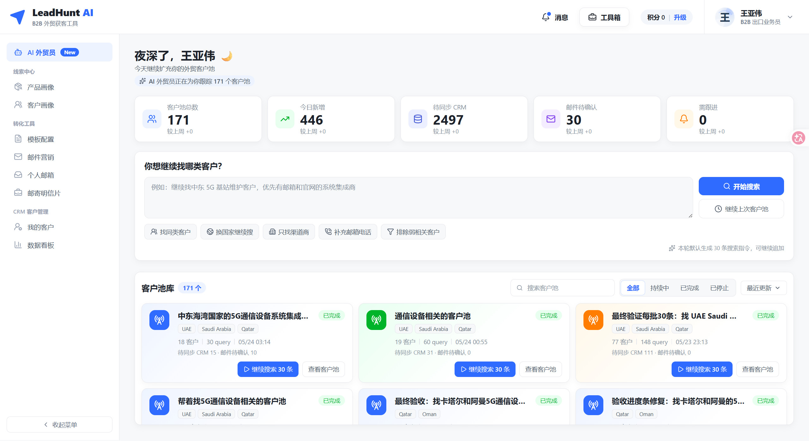
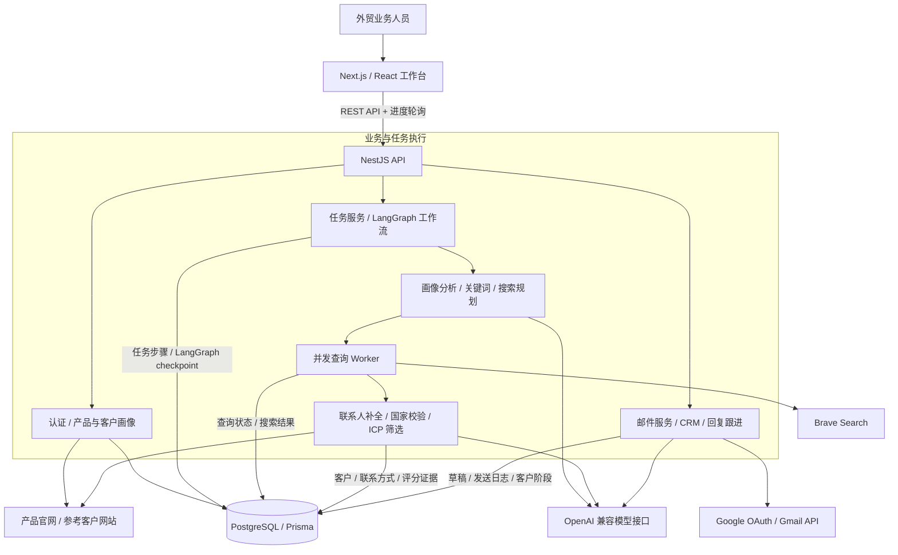
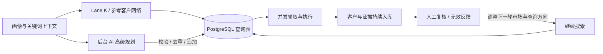

# LeadHunt AI

**面向 B2B 出海的 AI 获客与客户经营工作台。**

`TypeScript` · `LangGraph` · `Next.js 16` · `NestJS 11` · `PostgreSQL`

输入目标产品、市场和客户类型，LeadHunt AI 将开发任务转化为可执行的搜索计划，查找海外公司、补充联系方式、判断客户匹配度，并接入邮件开发、CRM 和回复跟进。

项目围绕一条完整的业务链路展开：

**产品与客户画像 → 多策略搜索 → 官网证据与联系方式 → ICP 筛选 → 人工确认 → 邮件触达 → CRM 与回复跟进。**



_开发环境工作台截图：创建搜索任务、查看客户池、继续追加搜索。图中数字为该环境的数据快照。_

## 能做什么

| 能力           | 使用方式与结果                                                                       |
| -------------- | ------------------------------------------------------------------------------------ |
| 自然语言获客   | 输入“寻找沙特和阿联酋的太阳能 EPC 承包商”，创建包含步骤、搜索指令和客户结果的任务    |
| 产品与客户画像 | 保存产品官网、产品页、参考客户、目标地区和补充资料，在执行任务时读取网页并分析       |
| 多策略检索     | 组合产品词、买家角色、应用场景和国家，结合 AI 高级查询与参考客户网络拓展             |
| 客户质量筛选   | 区分目标买家、待复核客户、采购情报、供应商、目录及内容页面，保留评分理由与风险       |
| 联系方式补全   | 从来源页和联系页提取邮箱、电话、社交链接及联系表单，记录对应来源                     |
| 持续经营客户池 | 查看客户详情、筛选高匹配客户、标记无效结果，在同一任务中继续追加搜索                 |
| 邮件开发       | 生成开发信草稿、使用模板与富文本编辑、AI 改写，支持 Gmail 草稿、单发、批量和定时发送 |
| CRM 与跟进     | 同步客户阶段，读取 Gmail 回复，识别意向并创建跟进任务，查看发送、打开和回复统计      |

## 系统架构

项目采用 **pnpm workspace Monorepo**，将界面、业务服务、Agent 编排和共享契约拆成四个工作空间。



| 层级       | 技术与职责                                                                 |
| ---------- | -------------------------------------------------------------------------- |
| Web        | Next.js 16、React 19、TypeScript；任务工作台、画像、客户池、邮件和数据看板 |
| UI 与编辑  | Lucide 图标、ECharts 图表、Tiptap 富文本编辑器                             |
| API        | NestJS 11；认证、权限校验、任务管理、CRM、Google OAuth 与 Gmail 集成       |
| Agent      | LangGraph JS；状态图、节点执行记录、人工确认与 checkpoint                  |
| AI         | OpenAI 兼容 Chat Completions 接口；模型名称和地址通过环境变量配置          |
| 搜索与网页 | Brave Search 客户端、官网正文与产品目录读取、联系页探测                    |
| 数据       | PostgreSQL、Prisma；业务数据与持久化 checkpoint                            |
| 工程       | pnpm workspace、TypeScript、Vitest、ESLint、Prettier、Prisma migrations    |

当前搜索任务由 **API 进程内的并发 Worker** 执行，查询状态与恢复信息保存在 PostgreSQL。Docker Compose 同时预留了 Redis 服务。

## 搜索与筛选如何实现

### 1. 从业务资料构建搜索上下文

任务上下文来自用户指令、产品画像、参考客户、官网证据和选定的 CRM 样本。网页读取模块提取标题、正文片段、产品名称与目录信息，再形成结构化的产品和客户画像。

关键词按产品、长尾产品、买家意图、市场、应用场景和排除词组织。任务指令与已保存画像存在行业冲突时，执行行业对齐，减少旧画像对新任务的干扰。

对应实现：[网页证据读取](https://github.com/wywzixin/LeadHunt-Codex/blob/main/apps/api/src/agent/website-content.service.ts)、[关键词扩展](https://github.com/wywzixin/LeadHunt-Codex/blob/main/packages/agent/src/keyword-expansion.ts)、[任务上下文](https://github.com/wywzixin/LeadHunt-Codex/blob/main/apps/api/src/agent/agent-workflow.service.ts)。

### 2. 快慢两阶段规划，与搜索并行推进

本分支把搜索规划拆成可先执行的快速查询和后台生成的高级查询：

| 路径            | 实现                                                     | 作用                                         |
| --------------- | -------------------------------------------------------- | -------------------------------------------- |
| Lane K 快速查询 | 根据已得到的画像与关键词，由后端组合产品、买家角色和国家 | 先建立一批可执行查询，提供基础召回           |
| AI 高级查询     | 模型结合画像、买家场景、搜索策略库和历史查询生成计划     | 补充更具体的买家、产品组、品牌生态和采购场景 |
| 参考客户网络    | 从参考客户的合作伙伴、项目及关联网络构造查询             | 扩展相似客户与关联公司线索                   |

快速查询先入库，Worker 随即开始搜索；高级规划在后台运行，将去重后的新查询追加到同一任务。Worker 在队列暂时为空时等待规划完成，继续消费新增查询。

默认初始规划以 **30 条搜索指令**为目标，Lane K 默认预算为 18 条，参考客户网络最多占 1 条，其余由高级规划补齐。高级规划失败时会记录原因，已有查询仍可继续执行。



核心入口：`runAutonomousLeadDiscovery`、`buildTaskFastContext`、`runSlowPlanningAndAppendGptQueries`，位于 [AgentWorkflowService](https://github.com/wywzixin/LeadHunt-Codex/blob/main/apps/api/src/agent/agent-workflow.service.ts)。

### 3. 用查询状态驱动并发执行

每条查询都有独立的状态、结果数和质量统计。Worker 默认并发数为 **3**，可通过 `LEADHUNT_SEARCH_QUERY_CONCURRENCY` 调整到 **1–5**。

- **原子领取**：使用带 `pending` 条件的数据库更新领取查询，只有成功将状态改为 `running` 的 Worker 执行该查询。
- **预算控制**：在领取前预留执行名额，竞争失败时回退计数，约束并发下的查询总量。
- **失败记录**：对搜索和候选保存设置阶段超时，记录失败查询，继续处理其余任务。
- **运行恢复**：维护任务心跳，启动时尝试恢复近期未完成任务，并处理过期的运行状态。
- **请求复用**：Brave 客户端包含短期缓存、请求间隔控制和可重试错误处理。
- **入库去重**：耗时的网页与 AI 分析先执行，再对任务内的候选持久化进行串行保护。

对应实现：[查询 Worker 与恢复](https://github.com/wywzixin/LeadHunt-Codex/blob/main/apps/api/src/agent/agent-workflow.service.ts)、[Brave 客户端](https://github.com/wywzixin/LeadHunt-Codex/blob/main/apps/api/src/search/brave-search.client.ts)、[候选入库](https://github.com/wywzixin/LeadHunt-Codex/blob/main/apps/api/src/leads/lead-qualification.service.ts)。

### 4. 结合规则、模型与证据判断客户质量

候选处理包含页面识别、公司归一化、联系方式探测、国家验证、规则评分和有预算限制的 AI 复核。

规则层检查行业与买家角色、页面类型、产品相关性、联系方式、卖方自身域名和参考客户域名等信号。模型层进一步判断公司属于目标买家、潜在买家、供应商、目录、文章还是采购情报，并输出理由、风险和置信度。

进入 AI 复核的候选使用 **60% AI 匹配分 + 40% 规则分**形成基础融合分，再应用风险、拒绝类型和分数约束。候选最终进入四类状态：

| 状态           | 含义                           |
| -------------- | ------------------------------ |
| `qualified`    | 通过筛选的客户                 |
| `review`       | 保留供人工进一步核实的候选     |
| `intelligence` | 采购、项目或内容情报，归档保存 |
| `rejected`     | 被质量规则或人工复核排除的结果 |

国家判断保留查询国家、推断国家、证据、置信度与冲突信息。电话区号、邮箱域名、网站域名、官网文本和服务区域参与判断；信息不足或冲突会体现在客户状态和风险中。

联系方式同样携带来源 URL，客户详情可追溯到**来源页面、来源查询、匹配理由与风险标签**。

对应实现：[LeadQualificationService](https://github.com/wywzixin/LeadHunt-Codex/blob/main/apps/api/src/leads/lead-qualification.service.ts)、[国家与地区解析](https://github.com/wywzixin/LeadHunt-Codex/blob/main/packages/agent/src/country-market.ts)。

### 5. 将结果质量反馈到下一轮检索

系统记录每条查询带来的客户与质量指标，汇总高产和低产查询、市场及策略方向。用户标记无效客户后，来源查询的质量统计随之更新；继续搜索时结合这些信号选择后续方向，并避开已有查询。

看板与任务结果关注的指标包括：

- 每 30 条查询的主客户数与高匹配客户数。
- 主客户联系方式覆盖率、明显错国家比例和候选拒绝率。
- 搜索策略覆盖、查询质量与客户证据完整度。
- 查询来源、国家和策略的产出差异。

对应实现：[查询效果与继续搜索](https://github.com/wywzixin/LeadHunt-Codex/blob/main/apps/api/src/agent/agent-workflow.service.ts)中的 `updateTaskQueryLearningSignals`、`buildQueryLearningSummary`、`appendContinuationSearchQueriesForTask`。

### 6. 用状态图组织执行、确认与恢复

[工作流定义](https://github.com/wywzixin/LeadHunt-Codex/blob/main/packages/agent/src/workflow.ts)包含 16 个节点，覆盖任务加载、画像分析、关键词、搜索、客户处理、审核、草稿、邮件发送和后续跟进。业务服务执行具体操作，并记录每一步的输入、输出、错误和状态。

流程设置两个关键人工确认点：**客户审核**与**邮件确认**。LangGraph checkpoint 默认持久化到 PostgreSQL，任务可跨请求保留确认状态；测试环境可使用内存存储。

模型输出统一经过 JSON 解析与 Zod Schema 校验。校验失败时，服务携带具体错误再请求一次修正；HTTP 层对限流及服务端错误提供有限重试。画像、关键词、搜索计划、买家评估、邮件改写和回复分类各自具有明确的输出契约。

对应实现：[状态图](https://github.com/wywzixin/LeadHunt-Codex/blob/main/packages/agent/src/workflow.ts)、[AI 服务与输出修正](https://github.com/wywzixin/LeadHunt-Codex/blob/main/apps/api/src/ai/leadhunt-ai.service.ts)、[结构化 Schema](https://github.com/wywzixin/LeadHunt-Codex/blob/main/apps/api/src/ai/leadhunt-ai.schemas.ts)。

## 邮件与 CRM 如何衔接

客户审核后创建开发信草稿，用户可以结合模板、富文本编辑器和 AI 改写完成内容，再确认发送或保存。Gmail 服务支持单条、批量及定时发送，并将发送日志、线程和客户阶段关联起来。

| 环节     | 实现                                                                                |
| -------- | ----------------------------------------------------------------------------------- |
| 邮箱授权 | Google OAuth；Gmail Token 使用 AES-256-GCM 加密存储，OAuth state 使用签名与过期校验 |
| 发送控制 | 每日额度、发送间隔、定时发送状态领取和发送日志                                      |
| 客户管理 | 线索进入 CRM，记录客户阶段、标签和阶段变化                                          |
| 回复同步 | 拉取关联 Gmail 线程，对新增回复去重并保存                                           |
| 意向识别 | 识别感兴趣、询价、索取目录、拒绝、退订、自动回复等类别，更新客户阶段和跟进任务      |
| 活动分析 | 汇总发送、回复、意向与邮件打开事件；打开数据作为趋势信号展示                        |

相关源码：[Gmail 服务](https://github.com/wywzixin/LeadHunt-Codex/blob/main/apps/api/src/gmail/gmail-message.service.ts)、[Token 加密](https://github.com/wywzixin/LeadHunt-Codex/blob/main/apps/api/src/gmail/token-encryption.ts)、[CRM](https://github.com/wywzixin/LeadHunt-Codex/blob/main/apps/api/src/crm/crm.service.ts)、[打开事件](https://github.com/wywzixin/LeadHunt-Codex/blob/main/apps/api/src/tracking/tracking.service.ts)。

## 本地运行

准备 **Node.js 24、pnpm 10.29.3、Docker Compose**，以及模型与 Brave Search 的有效 API 凭据。

```bash
git clone https://github.com/wywzixin/LeadHunt-Codex.git
cd LeadHunt-Codex
pnpm install --frozen-lockfile
cp .env.example .env
```

在根目录 `.env` 中配置：

| 变量                                      | 说明                                                             |
| ----------------------------------------- | ---------------------------------------------------------------- |
| `DATABASE_URL`                            | PostgreSQL 连接；示例配置与本地 Compose 默认值对应               |
| `OPENAI_BASE_URL`                         | 支持 Chat Completions 的接口地址，通常以 `/v1` 结尾              |
| `OPENAI_API_KEY` / `OPENAI_MODEL`         | 模型凭据与模型名；示例模型名为 `gpt-5.5`，按接口实际支持情况填写 |
| `BRAVE_SEARCH_API_KEY`                    | Brave Search 凭据                                                |
| `LANGGRAPH_CHECKPOINT_STORE`              | 本地完整体验使用 `postgres`                                      |
| `SESSION_SECRET` / `TOKEN_ENCRYPTION_KEY` | 为本地环境设置独立随机值；启用 OAuth 与 Gmail 时使用             |

然后初始化数据库与共享包，启动服务：

```bash
docker compose up -d postgres
pnpm --filter @leadhunt/api prisma generate
pnpm --filter @leadhunt/api prisma migrate deploy
pnpm --filter @leadhunt/shared build
pnpm --filter @leadhunt/agent build
pnpm dev
```

Web 默认运行在 `http://localhost:3000`，API 默认为 `http://localhost:4000`。注册账号后，先设置产品与客户画像，再创建搜索任务。

需要 Gmail 功能时，额外配置 `GOOGLE_CLIENT_ID`、`GOOGLE_CLIENT_SECRET`，并将 `GOOGLE_REDIRECT_URI` 设为 `http://localhost:4000/api/gmail/oauth/callback`。Google 登录的默认回调为 `http://localhost:4000/api/auth/google/callback`；在 Google 控制台按启用的功能登记对应地址。

## 源码阅读索引

| 目录或文件                                                                                                                           | 建议关注                                               |
| ------------------------------------------------------------------------------------------------------------------------------------ | ------------------------------------------------------ |
| [`apps/web/app`](https://github.com/wywzixin/LeadHunt-Codex/tree/main/apps/web/app)                                   | 页面、工作台、客户详情、模板与邮件编辑                 |
| [`apps/api/src/agent`](https://github.com/wywzixin/LeadHunt-Codex/tree/main/apps/api/src/agent)                       | 任务创建、快慢规划、并发执行、恢复、质量反馈与人工确认 |
| [`apps/api/src/leads`](https://github.com/wywzixin/LeadHunt-Codex/tree/main/apps/api/src/leads)                       | 候选归一化、联系方式、国家证据与 ICP 规则              |
| [`apps/api/src/ai`](https://github.com/wywzixin/LeadHunt-Codex/tree/main/apps/api/src/ai)                             | 模型客户端、Prompt、JSON Schema 与校验修正             |
| [`apps/api/src/search`](https://github.com/wywzixin/LeadHunt-Codex/tree/main/apps/api/src/search)                     | 搜索策略服务、Brave 请求、缓存与错误处理               |
| [`apps/api/src/gmail`](https://github.com/wywzixin/LeadHunt-Codex/tree/main/apps/api/src/gmail)                       | OAuth、草稿、发送、定时任务和回复同步                  |
| [`apps/api/prisma/schema.prisma`](https://github.com/wywzixin/LeadHunt-Codex/blob/main/apps/api/prisma/schema.prisma) | 任务、查询、客户、评分、草稿、发送及跟进的数据关系     |
| [`packages/agent/src`](https://github.com/wywzixin/LeadHunt-Codex/tree/main/packages/agent/src)                       | LangGraph 状态图、关键词、搜索策略与国家解析           |
| [`packages/shared/src`](https://github.com/wywzixin/LeadHunt-Codex/tree/main/packages/shared/src)                     | 前后端共享定义                                         |
| [`search`](https://github.com/wywzixin/LeadHunt-Codex/tree/main/search)                                               | 高级搜索策略库                                         |

## 开发与验证

```bash
pnpm typecheck
pnpm lint
pnpm test
pnpm build
```

仓库中的 Vitest 用例覆盖工作流、搜索规划、关键词、国家解析、客户筛选、认证、Gmail、CRM 和事件追踪等模块。搜索与邮件集成需要在配置相应服务后验证。

当前分支处于 **Beta 迭代阶段**，重点围绕搜索产出、客户证据质量和完整业务流程持续完善。
