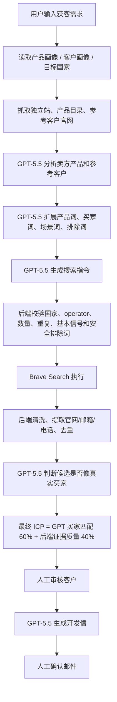

# LeadHunt AI 已完成工作记录 04

更新时间：2026-05-15 +08:00

说明：本文记录 `done03.md` 之后，本轮“GPT-5.5 回到 AI 外贸员主链路”的实现进展。不要在本文记录 `.env`、API Key、OAuth secret、refresh token、access token、cookie、账号密码等敏感信息。

## 本轮目标

用户确认：不要再让 AI 外贸员只是后端模板拼搜索词，而是让 GPT-5.5 真正参与“理解产品、理解客户、生成搜索策略、判断客户质量”。后端只负责边界、校验、执行、去重、保存和人工节点。

目标链路：



## 已完成改造

### 1. 产品目录抓取限制放宽

- 修改文件：`apps/api/src/agent/website-content.service.ts`
- 产品目录抓取页数从 8 页提高到 50 页。
- 产品名保留数量从 160 个提高到 1000 个。
- `WebsiteContentService` 会读取产品画像中的官网、产品页、资料 URL；对 WooCommerce 产品目录会识别分页、产品总数和产品标题。
- 对 `https://telecorenet.com/products` 的实际抓取结果：可读到 14 页、158 个产品，未因 8 页限制提前停止。

新增测试：

- `apps/api/src/agent/website-content.service.spec.ts`
- 测试项：`can read a 158 item WooCommerce catalog without stopping at eight pages`

### 2. GPT-5.5 搜索策略接入主链路

- 修改文件：
  - `apps/api/src/agent/agent.module.ts`
  - `apps/api/src/agent/agent-workflow.service.ts`
  - `apps/api/src/ai/leadhunt-ai.prompts.ts`

AI 外贸员创建任务时，现在会：

1. 读取产品画像、客户画像和 CRM 样本。
2. 抓取产品站、产品目录和参考客户官网。
3. 先生成确定性兜底关键词和搜索指令。
4. 调用 GPT-5.5 分析产品画像。
5. 调用 GPT-5.5 分析客户画像。
6. 调用 GPT-5.5 扩展关键词。
7. 调用 GPT-5.5 生成搜索策略和 query。
8. 后端校验 GPT query，不通过的丢弃。
9. GPT query 不足时，用原有确定性策略补足至少 15 条。

后端校验只做边界，不替 GPT 判断客户价值：

- 只允许 `supported` / `experimental` 的自动执行策略进入 Brave。
- 每条 query 必须落到目标国家 / 市场池。
- 每条 query 必须包含国家词，并至少命中产品词、客户词或场景词之一。
- 自动补充安全排除词，例如 `-job`、`-career`、`-hiring`、`-training`。
- 去重、截断过长 query、过滤空 query。
- GPT 失败时 fallback 到原有 `generateSearchQueries()`，保证任务不断。

任务 `inputPayload.profileSignals.aiPlanning` 会记录：

- 是否启用 GPT planning。
- 搜索指令来源：`gpt55_with_deterministic_fallback` 或 `deterministic_fallback`。
- GPT 生成 query 数量。
- fallback query 数量。
- fallback 原因。

### 3. GPT-5.5 候选买家判断

- 修改文件：
  - `apps/api/src/ai/leadhunt-ai.schemas.ts`
  - `apps/api/src/ai/leadhunt-ai.prompts.ts`
  - `apps/api/src/ai/leadhunt-ai.service.ts`
  - `apps/api/src/leads/lead-qualification.service.ts`

新增 GPT 结构化输出：

```json
{
  "resultType": "target_buyer",
  "buyerType": "base station maintenance company",
  "fitScore": 86,
  "confidence": 0.82,
  "decision": "qualified",
  "matchedSignals": ["cell site maintenance", "Huawei spare parts"],
  "risks": ["email not found"]
}
```

支持的候选类型：

- `target_buyer`
- `possible_buyer`
- `supplier_or_competitor`
- `directory`
- `content_article`
- `job_page`
- `market_report`
- `irrelevant`
- `unknown`

最终 ICP 融合方式：

- GPT 买家匹配分占 60%。
- 后端规则证据分占 40%。
- 目录页、文章页、招聘页、市场报告、无关页会被封顶到低分。
- GPT 标记为 `supplier_or_competitor` 时最高只进入复核，不直接当高分买家。
- GPT 高置信判断为真实买家时，允许进入高匹配。

### 4. 前端画像页读取已保存配置

- 修改文件：
  - `apps/web/app/product-profile/product-profile-form.tsx`
  - `apps/web/app/customer-profile/customer-profile-form.tsx`

产品画像页现在会加载后端已保存的官网、产品页、资料 URL、关键词和备注，不再只显示默认值。

客户画像页现在会加载后端已保存的目标地区、参考客户官网、行业关键词和备注。目标地区会规范化：如果用户选择了具体国家 / 地区，就自动去掉 `Global`，避免搜索时国家池被冲散。

### 5. UI 搜索口径调整

- 修改文件：`apps/web/app/ai-worker-client.tsx`

AI 外贸员页面把“再次搜索”相关文案改成“继续找更多客户”。默认任务和示例 prompt 也从泛“通信设备经销商”改为更贴近通信配件真实买家：

- 基站维护
- RAN 维护
- 铁塔维护
- 通信电源维护
- 系统集成商
- 运营商
- ISP / FTTH 网络运维客户

候选客户默认展示也过滤掉 `rejected` 和低于 50 分的结果，避免把明显弱线索直接放到主候选表。

## 当前仍未完成

完整长期客户池还未落库完成，以下仍是下一阶段：

- `lead_pools`
- `lead_search_rounds`
- `lead_dedupe_keys`
- `lead_candidate_events`
- 跨任务 / 跨轮次客户去重
- 基于用户审核通过 / 拒绝反馈的下一轮 query 学习

当前“继续找更多客户”已经在 UI 文案和单任务搜索批次上修正，但还不是完整长期客户池闭环。

## 本轮验证记录

已通过的代码级验证：

- `pnpm --filter @leadhunt/api typecheck`
- `pnpm --filter @leadhunt/web typecheck`
- `pnpm --filter @leadhunt/agent typecheck`
- `pnpm --filter @leadhunt/api test -- src/ai/leadhunt-ai.service.spec.ts src/agent/website-content.service.spec.ts src/agent/agent-workflow.service.spec.ts src/leads/lead-qualification.service.spec.ts`
- `pnpm --filter @leadhunt/agent test`
- `pnpm --filter @leadhunt/api build`
- `pnpm --filter @leadhunt/agent build`

本地浏览器验证：

- 页面：`http://localhost:3000/`
- API：`http://localhost:4000/health` 返回 `200 {"status":"ok" ...}`
- 产品画像页正确读取已保存配置：`https://telecorenet.com/`、`https://telecorenet.com/products`、产品关键词和备注。
- 客户画像页正确读取已保存配置：`https://spectrummea.com/`、`https://highcloud.ae/` 和补充说明。
- 新建测试任务：`591215bb-8b7e-40a9-bc3c-96c0762cef48`
- 测试 prompt：`帮我找5G通信设备配件相关的买家客户，目标 Nigeria 和 Saudi Arabia，优先基站维护、RAN维护、铁塔维护、通信电源维护、运营商和ISP/FTTH网络运维客户。`
- 网站证据读取：4/4 成功，包含 `telecorenet.com`、`telecorenet.com/products`、`spectrummea.com`、`hctgroup.ae`。
- 生成搜索指令：55 条，任务输入中的 Nigeria / Saudi Arabia 生效，并扩展到 Lagos、Riyadh、Jeddah 等市场词。
- 首批搜索：执行 15 条 query，其中 11 条完成、4 条失败，Brave 原始命中偏少。
- 候选结果：低分 / rejected 结果不会展示在主候选表；中低分 review 仍可供人工复核。

重要运行时发现：

- 本次真实运行时，GPT-5.5 兼容接口连续返回 HTTP 503：`Service temporarily unavailable`。
- 因此 `aiPlanning.querySource` 为 `deterministic_fallback`，`gptSearchQueryCount=0`，`fallbackQueryCount=55`。
- 候选客户 `aiEvaluation` 为空，原因也是 GPT-5.5 服务 503 后走了兜底规则分。
- 这说明代码已经把 GPT-5.5 接入主链路，但当前外部 GPT 服务不可用时会按设计 fallback；后续验证 GPT 真正参与时，需要先确认 GPT-5.5 接口恢复正常。
